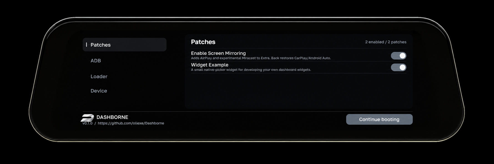
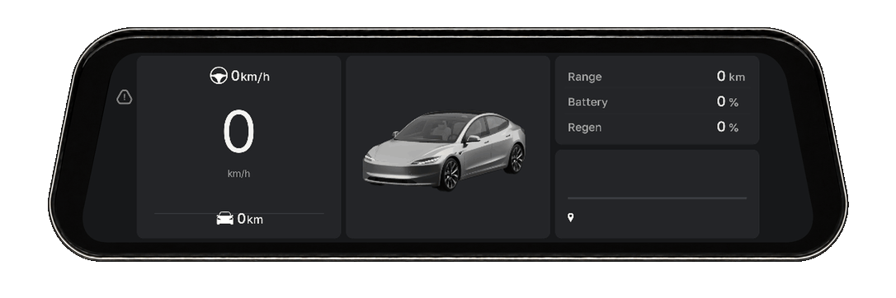

> [!IMPORTANT]
> Dashborne is a community-driven hobby project, not affiliated with Enhance Ltd. or Tesla, Inc.
> No vendor firmware or proprietary libraries are bundled.
> Provided **as is**, without warranty—use at your own risk.


# Dashborne

Dashborne is an ADB enabler, extension loader, and app loader for the S3XY DASH's
official Linux-based OS. It gives users the tools to modify every aspect of the
DASH's software or load custom apps. It loads extensions from a microSD card and
applies them temporarily, without writing them to the DASH's internal flash memory.

## FAQ

<details>
<summary>What does it allow?</summary>

You can change the DASH's UI and behavior, add features through extensions,
load custom apps, and enable ADB for development.

</details>

<details>
<summary>Can it brick my device?</summary>

Dashborne's normal extension loading leaves the OS in flash untouched.
Custom apps and extensions run with system privileges, so code that writes to
internal storage can still damage the system.

</details>

<details>
<summary>Are these extensions permanent?</summary>

No; Dashborne's normal extensions apply only while running from the card.
Power off and remove the microSD card to boot the unpatched OS.

</details>

<details>
<summary>What if an extension fails to load?</summary>

Dashborne warns you, disables extensions that fail to load, and continues booting.
If an extension crashes later, use opt-in Auto recovery or restart and disable it in the boot menu.

</details>

<details>
<summary>Can I create my own apps and extensions?</summary>

Yes, you can build custom apps and extensions for the DASH's Linux platform.
Use the [extension SDK](dashborne/extensions/README.md) for extensions and the
[Loader](dashborne/README.md) to launch compatible apps from microSD.

</details>

<details>
<summary>Can S3XY DASH run DOOM?</summary>

Yes.

</details>

## Install

Download the microSD ZIP from the [latest release](https://github.com/oliexe/Dashborne/releases/latest)
and extract it.

1. Prepare a microSD card with an **MBR partition table and a FAT32 partition**.
   We tested an 8 GB FAT32 partition. Formatting erases the card.
2. On a fresh card, copy everything inside the ZIP's `card/` directory to the
   card root: **`Dashborne/`**, **`EasyUI.cfg`** and **`dashborne.conf`**.
   For an upgrade, run this from the extracted ZIP using Python 3.10+:
   ```sh
   python3 install.py --card /Volumes/CARD
   ```
   Replace `/Volumes/CARD` with its mount path. The installer preserves your
   settings and startup backup.
3. Eject the card, insert it into the powered-off DASH, then power on.
   **Tap the splash within three seconds** to configure Dashborne; otherwise it
   continues to the official dashboard with your selected extensions.

For developer Wi-Fi, open **ADB → Wi-Fi network** in the boot menu, enter your
SSID and password with the on-screen keyboard, then save and enable ADB.
ADB is off by default.
Power off and remove the card to boot the original dashboard without Dashborne.

## Boot menu

With a Dashborne microSD card inserted, the S3XY DASH shows the Dashborne boot
screen at startup. **Tap the screen within three seconds** to enter the boot menu;
otherwise, Dashborne continues to the official dashboard with your selected extensions.



- Extensions: enable or disable extensions on your microSD card.
- ADB: enable root access over Wi-Fi, useful for development and modding the device.
- Loader: browse and launch compatible apps from microSD, with optional autolaunch.
- Device: view hardware details, software versions, serials and system information.
- Update Dashborne: connect to Wi-Fi, choose a compatible GitHub release and install it on the card.
  Rollback restores the previous installation while keeping your current settings.

Dashborne saves preferences in the card-root `dashborne.conf`.
See [configuration and operation](dashborne/README.md).

## Extensions

Custom extensions can modify any part of the DASH's Linux-based OS, including
its UI, features, and behavior. Dashborne includes the
[Extra menu](dashborne/core/extra-menu) and
[widget runtime](dashborne/core/widget-runtime), which extensions can use to add
entries to the floating Extra menu or build custom widgets for the stock widget picker.



| Name | Description | OS Version |
| --- | --- | --- |
| [Tesla Skin](extensions/tesla-skin) | Tesla-inspired light and dark styling for the stock dashboard, Settings and widget picker. | 6.11.2, 6.11.4 |
| [Development Menu](extensions/development-menu) | Opens the hidden stock Settings category without a password. | 6.11.2, 6.11.4 |
| [Tesla Model Widget](extensions/tesla-model) | A 2×2 animated car-state widget with tap-to-change model variants. Requires a separately installed model pack. | 6.11.2, 6.11.4 |
| [Screen Mirroring](extensions/screen-mirroring) | AirPlay and experimental Miracast in a shared viewer with aspect controls; Back restores CarPlay/Android Auto. | 6.11.2, 6.11.4 |

Version targets refer to the stock DASH application version.

See the [extension development guide](dashborne/extensions/README.md) to build your own.
The [Widget Example](extensions/widget-example) provides boilerplate for adding
custom widgets to any stock picker category.

If you'd like to publish an extension you've built, open a pull request adding it
to [`/extensions`](extensions).

## ADB Debugging

Dashborne includes a Wi-Fi ADB enabler that gives you root access to the DASH's
Linux system. You can read firmware and system files, make changes on the fly,
debug applications, and reverse-engineer the device's software.

Refer to the [boot menu](#boot-menu) section to enable the ADB bridge.

For autonomous testing, **Force ADB** keeps the development Wi-Fi connection
while the stock dashboard runs, blocking its switch to a CarPlay/Android Auto
hotspot. **Auto recovery** saves crash diagnostics to the microSD and returns
to the boot menu with a Linux reboot if the UI exits or stops responding. Both options are off by
default. See [connection and recovery details](dashborne/README.md#adb-connection-handling).

## Development

```text
dashborne/             Boot menu, configuration, ADB, Loader, Device and Update Dashborne
  extensions/          Native extension engine and SDK
  patches/             Layout patch engine, compiler and definitions
extensions/            Bundled extensions
docs/                  Platform and SD loading research
```

Build with Python 3.10+, Clang/LLVM, LLD, CMake, Ninja and Make; host tests also need zlib.
The first build downloads checksum-pinned C dependencies for the updater and caches them
in `dashborne/build/`.
From the repository root:

```sh
sh dashborne/build.sh
sh test.sh
```

For Homebrew LLVM/LLD on macOS:

```sh
DASHBORNE_CC=/opt/homebrew/opt/llvm/bin/clang \
DASHBORNE_LD=/opt/homebrew/opt/lld/bin/ld.lld \
sh dashborne/build.sh
```

The build packages Dashborne and the bundled extensions into `dashborne/build/card/`.
Install a source build with `python3 dashborne/install.py --card /Volumes/CARD`,
or create a downloadable ZIP with `python3 tools/release.py`.

The [build workflow](.github/workflows/release.yml) builds and tests pushes to
`main`, pull requests and manual runs. To publish a release, update `VERSION` and
the core [changelog](CHANGELOG.md), commit them, then push a matching `vX.Y.Z` tag.
The workflow publishes the ZIP and its SHA-256 checksum after the tests pass.

The [local stock OS preflight tools and AI skill](docs/stock-preflight.md) inspect
update packages and prepare a compatibility report before you update your DASH.

See the [extension SDK](dashborne/extensions/README.md),
[layout patches](dashborne/patches/README.md), and [platform research](docs/research.md).

# Device Exploration

## Hardware

The S3XY DASH is an Enhance Ltd. instrument cluster, registered under
[FCC ID 2BUSZ-S3XYDASH](https://fccid.io/2BUSZ-S3XYDASH).

| Component | What we know | Source |
| --- | --- | --- |
| Processor | Allwinner T113 family; the submitted manual specifies a dual-core T113-S at 1.2 GHz. | [Internal photos, p. 2][photos]; [manual, p. 3][manual] |
| Display | 9.6-inch IPS touchscreen, 1920 × 480. | [Manual, p. 3][manual] |
| Wireless | Realtek RTL8733BS Wi-Fi/Bluetooth, plus a separate BLE module. | [Chipset declaration][chipsets]; [internal photos][photos] |
| Storage | Kingston-branded eMMC; capacity not yet established. | [Internal photos, p. 2][photos] |
| Power | USB-C. | [Enhance product FAQ](https://www.enhauto.com/pages/dash) |
| Expansion | microSD mounted at `/mnt/extsd`; application loading from FAT32 verified on our unit. | [On-device research](docs/research.md) |

Other aftermarket Tesla clusters have similar published specifications. The
comparisons below include the DASH's FCC manual, which Enhance's CEO has since
identified as a placeholder template rather than final product documentation.

| Product | Published similarities |
| --- | --- |
| [Yeslak T9](https://www.yeslak.com/products/9-6-carplay-instrument-cluster-for-tesla-model-3-y-ly) | T113-S dual-core 1.2 GHz, Linux, 9.6-inch 1920 × 480 IPS display, 258 × 75 × 15 mm and 323 g, also listed in the DASH's placeholder [FCC manual, p. 3][manual]. |
| [TESLASY T9 Gen 2](https://www.teslasy.com/products/model-3-y-model-3-highland-t9-9-6-inch-gen-2-carplay-instrument-cluster-head-up-touch-display) | 9.6-inch Linux cluster with CarPlay, Android Auto, OTA updates and magnetic mounting; the listing does not identify its processor. |
| [TESERY 9.6-inch cluster](https://www.tesery.com/products/9-6-inch-instrument-cluster-dashboard-display-for-tesla-model-3-y) | Linux, 1920 × 480 IPS display, CarPlay and Android Auto; the listing does not identify its processor. |

## Software

The DASH runs Linux 5.4.61 with ARMv7 hard-float userspace and the
ZKSWE/FlyThings UI framework. See the [on-device research](docs/research.md).

[photos]: https://fccid.io/2BUSZ-S3XYDASH/Internal-Photos/Internal-photos-9104326.pdf
[manual]: https://fccid.io/2BUSZ-S3XYDASH/User-Manual/User-manual-9104334.pdf
[chipsets]: https://fccid.io/2BUSZ-S3XYDASH/Attestation-Statements/Kaspersky-Statement-9104348.pdf
